# ER Diagram

The diagram below is written in Mermaid. GitHub and VS Code (with the
"Markdown Preview Mermaid Support" extension) draw it automatically. You
can also paste `database/er_diagram.mmd` into <https://mermaid.live> and
export a PNG for your report.

```mermaid
erDiagram
    USERS ||--o{ VEHICLES : "owns"
    USERS ||--o{ RESERVATIONS : "makes"
    USERS ||--o{ WAITING_LIST : "joins"
    USERS |o--o{ CHARGER_MAINTENANCE : "reports"
    VEHICLES ||--o{ RESERVATIONS : "is parked in"
    VEHICLES ||--o{ WAITING_LIST : "waits with"
    LOCATIONS ||--|{ PARKING_SLOTS : "contains"
    LOCATIONS ||--o{ WAITING_LIST : "requested at"
    LOCATIONS |o--o{ PRICING_RULES : "overrides price"
    PARKING_SLOTS ||--o| CHARGERS : "has (EV slots only)"
    PARKING_SLOTS ||--o{ RESERVATIONS : "is booked by"
    CHARGERS ||--o{ CHARGER_MAINTENANCE : "has tickets"
    RESERVATIONS ||--o{ PAYMENTS : "is paid by"
    RESERVATIONS |o--o| WAITING_LIST : "offer for"

    USERS {
        int user_id PK
        varchar email UK
        varchar phone UK
        varchar role
        varchar membership_tier
        boolean has_accessibility_permit
    }
    VEHICLES {
        int vehicle_id PK
        int user_id FK
        varchar registration_no UK
        varchar vehicle_type
        boolean is_ev
        varchar connector_type
    }
    LOCATIONS {
        int location_id PK
        varchar name
        varchar city
        char pincode
        boolean is_active
    }
    PARKING_SLOTS {
        int slot_id PK
        int location_id FK
        varchar slot_code
        varchar slot_type
        varchar size_class
        varchar occupancy_status
    }
    CHARGERS {
        int charger_id PK
        int slot_id FK
        varchar charger_type
        varchar connector_type
        numeric power_kw
        varchar status
    }
    CHARGER_MAINTENANCE {
        int maintenance_id PK
        int charger_id FK
        int reported_by FK
        timestamptz reported_at
        timestamptz resolved_at
    }
    RESERVATIONS {
        int reservation_id PK
        int user_id FK
        int vehicle_id FK
        int slot_id FK
        tstzrange booking_period
        varchar status
        timestamptz hold_expires_at
        numeric total_amount
    }
    WAITING_LIST {
        int entry_id PK
        int user_id FK
        int vehicle_id FK
        int location_id FK
        smallint priority
        varchar status
        int offered_reservation_id FK
    }
    PAYMENTS {
        int payment_id PK
        int reservation_id FK
        numeric amount
        varchar payment_type
        varchar status
    }
    PRICING_RULES {
        int rule_id PK
        int location_id FK
        varchar applies_to
        numeric rate_per_hour
    }
    PEAK_HOURS {
        int peak_id PK
        time start_time
        time end_time
        numeric multiplier
    }
    BOOKING_POLICY {
        smallint policy_id PK
        int hold_minutes
        int grace_minutes
    }
    AUDIT_LOGS {
        bigint log_id PK
        varchar table_name
        int record_id
        varchar new_status
    }
```

The full version, with every column, is in `database/er_diagram.mmd`.
`PEAK_HOURS`, `BOOKING_POLICY` and `AUDIT_LOGS` have no foreign keys. They
are configuration and log tables.

## Conceptual entities

| Entity | What one row is | Mandatory (from PPT) |
|---|---|---|
| USERS | A driver or an administrator | ✔ |
| LOCATIONS | A parking site (mall, metro station, campus) | ✔ |
| PARKING_SLOTS | One physical space at a location | ✔ |
| CHARGERS | The EV charger installed at an EV slot | ✔ |
| RESERVATIONS | A booking of one slot for one time range | ✔ |
| WAITING_LIST | A request to be notified when capacity frees up | ✔ |
| VEHICLES | A car / SUV / bike belonging to a user | supporting |
| PAYMENTS | A simulated payment or refund | supporting |
| PRICING_RULES, PEAK_HOURS, BOOKING_POLICY | Configurable business numbers | supporting |
| CHARGER_MAINTENANCE | A fault ticket for a charger | supporting |
| AUDIT_LOGS | A status change written by a trigger | supporting |

The PPT lists "Driver + vehicle details" under USERS. We split vehicles
into their own table because one driver can own several vehicles. Keeping
them in USERS would need repeating columns (vehicle1, vehicle2, …), which
breaks first normal form (1NF).

## Relationships and cardinalities

| Relationship | Cardinality | Meaning / how it is enforced |
|---|---|---|
| USERS → VEHICLES | 1 : N | A user owns zero or more vehicles; `vehicles.user_id` FK, `ON DELETE CASCADE` |
| USERS → RESERVATIONS | 1 : N | `reservations.user_id` FK, `ON DELETE RESTRICT` (booking history must not vanish) |
| VEHICLES → RESERVATIONS | 1 : N | Which car is parked; the vehicle must belong to the same user (trigger check) |
| LOCATIONS → PARKING_SLOTS | 1 : N (at least 1 in practice) | `slot_code` is unique **within** a location |
| PARKING_SLOTS → CHARGERS | 1 : 0..1 | `UNIQUE(chargers.slot_id)` makes it at most one; a trigger allows chargers only on EV slots |
| PARKING_SLOTS → RESERVATIONS | 1 : N | Many bookings over time, but **never two active overlapping ones** (EXCLUDE constraint) |
| CHARGERS → CHARGER_MAINTENANCE | 1 : N | Many tickets over time; at most one open ticket (partial unique index) |
| RESERVATIONS → PAYMENTS | 1 : N | Booking payment, later a fine payment; failed attempts are also rows |
| USERS / VEHICLES / LOCATIONS → WAITING_LIST | 1 : N each | Who waits, with which car, where |
| WAITING_LIST → RESERVATIONS | 0..1 : 0..1 | An entry that was OFFERED points to the reservation created for it (`UNIQUE`) |
| LOCATIONS → PRICING_RULES | 0..1 : N | `location_id NULL` = default rule for every location |

### Why the reservation does not store `charger_id`

A slot has at most one charger, so `slot_id → charger_id`. Storing
`charger_id` in RESERVATIONS would create the transitive dependency
`reservation_id → slot_id → charger_id`, which violates 3NF. The
`v_reservation_details` view joins it in whenever it is needed.
